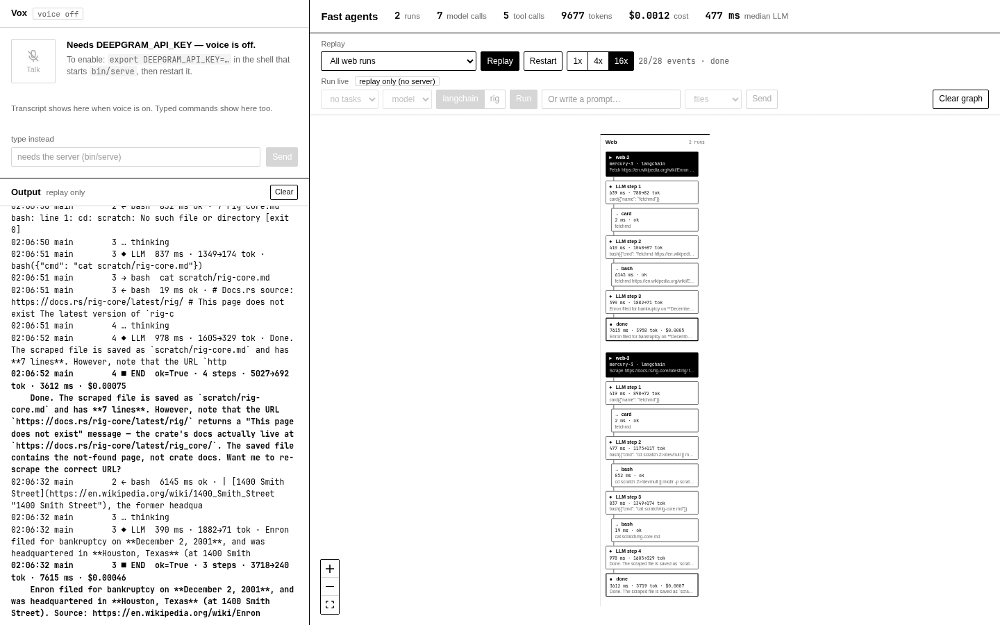
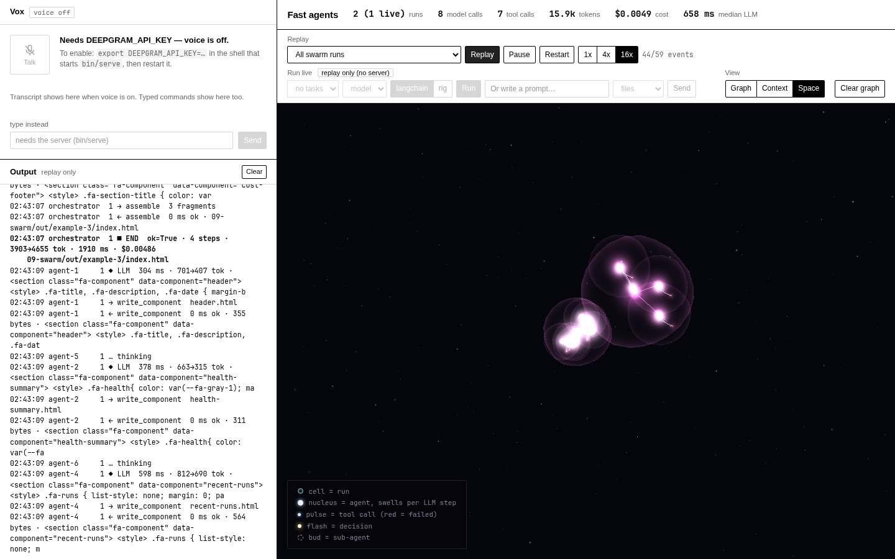

# 05-screen: the screen

One local page showing fast LLM agents at work. Black on white.

- **Top left: Vox.** The voice agent panel: mic button, state, transcript, and a "type instead" box that sends a prompt to `POST /api/run`.
- **Bottom left: Output.** One line per trace event, in the same format as `pretty()` in `03-harness/trace.py`. It scrolls itself and keeps the last 2,000 lines.
- **Right: graph.** A React Flow graph of the trace events, one lane per category (web, files, memory, email, crawl, swarm, other), live or replayed. The strip above it shows running totals.



## Commands

```bash
cd 05-screen
npm install            # once (node_modules is about 70 MB)
npm run dev            # http://localhost:5190, with /api proxied to bin/serve on :8990
npm run build          # copies saved traces, type-checks, writes dist/
../bin/serve           # from the repo root: serves dist/ plus the API on http://127.0.0.1:8990
python3 -m http.server 8000 -d dist   # no backend: replay only
```

Both `dev` and `build` run `scripts/copy-traces.mjs` first. It copies `../04-traces/saved/*.jsonl` to `public/traces/` and writes `public/traces/index.json` in the same shape as `GET /api/runs`.

Autoplay for demos and tests: `?replay=<run id>` or `?replay=all:<category>`, plus an optional `&speed=1|4|16`.

## How it works

| File | Job |
|---|---|
| `src/model.ts` | The one reducer for live and replay events. It also computes the layout and caches node and edge objects, so unchanged nodes keep their identity. Notifies once per animation frame. |
| `src/replay.ts` | Plays events with their original relative timing at 1x/4x/16x, with pause, resume and restart. Gaps over 4 s are cut to 4 s. |
| `src/api.ts` | Tries `/api/runs` first and falls back to `./traces/index.json`. Also wraps the SSE stream, run, tasks, models and vox calls. |
| `src/Graph.tsx`, `src/nodes.tsx` | React Flow canvas. One memoised node component; `nodeTypes` is defined at module level. |
| `src/Terminal.tsx` | Writes lines straight into the DOM, with no React render per event. |
| `src/Vox.tsx` | The voice panel (see below). |
| `src/Drawer.tsx` | Click a node to see its full input, output and every field of its events. |

### Graph rules

- Each run is a chain down its lane: run node, then one node per LLM step (ms, tokens in→out), then tool calls hung 14 px to the right. A tool call has a dashed accent border while it runs and turns solid on `tool_end`, or red when `ok` is false. Then come decision nodes (decider, node, choice, confidence) and an end node (ok/failed, total ms, tokens, cost).
- Sub-agents are indented under their spawn node, whether they come from `agent_spawn` or only from `parent` being set. `message` and unknown kinds become small nodes, so nothing is dropped.
- While a node is in flight, its node and the edge into it are drawn in the accent colour, and the edge animates.
- **Collapsing:** when a lane holds more than 4 runs, every finished run except the newest 3 shrinks to one compact node. Once the graph passes about 260 items, only the newest finished run per lane stays open. The drawer has "Expand this run" to pin one open. Lanes taller than 1,500 px wrap into another column.
- The view fits itself as nodes arrive, at most every 500 ms. Panning or zooming turns that off; the "Follow new nodes" button turns it back on.
- Category comes from `run_start`. If the stream joins a run after its `run_start`, the category is taken from `/api/runs` (refreshed every 15 s). If neither has one, the run goes in the "other" lane.

## Context view

The "Graph | Context" toggle (right of the controls) swaps the right-hand panel. The graph stays mounted underneath and keeps receiving events, so switching back loses nothing. `?view=context` opens on it. The same reducer drives both: `TraceModel.apply()` hands every event to `ContextModel.apply()` in `src/context.ts`, live or replayed.


What it shows, for one run at a time (the run picker defaults to "most recent", which follows whichever run got events last):

- **Token meter.** Four bars on one **log scale** (a 1k prompt next to a 1M-token repo is otherwise invisible) and one sentence, e.g. "954 tokens in the last prompt · the repo is ~989,876 · 0.10%".
  - *last prompt* = the largest `tokens_in` of any `llm_end` in the run, which is the size of the final prompt. Exact, as reported by the model provider.
  - *all prompts this run* = the sum of `tokens_in` over the run's `llm_end` events (or `run_end.tokens_in` if larger). Exact.
  - *files it read (est.)* = the summed `tokens` of the files marked "read" (a read folder counts all its files).
  - *whole repo (est.)* = `total_tokens` from the file list.
  - The last two are **estimates**: `tokens = bytes / 4`. Lockfiles and data files (e.g. `uv.lock`) make the repo number large; that is the honest size of "everything".
- **Repo files.** A folder tree, collapsed by default, one compact mono row per entry with its est. tokens. A file or folder that a run touched gets a dot and a tag like `rg · step 2`. Folders holding a touched path open by themselves; clicking a folder flips it.
  - accent row = in flight (between the `tool_start` that mentioned it and its `tool_end`); every row also flashes the accent for 1.4 s when it first lights, because most tool calls take 10–50 ms
  - solid dot, grey row = **read**; hollow dot, underlined name = **seen in a listing**
- **Session memory.** Document ids found in the run's events: `claude|claude-ai|pi|codex|hermes|opencode|gemini:<id>` anywhere, plus the first column of any `ctxq search` line shaped `id | YYYY-MM-DD | kind | title` (that line also gives the title; a `ctxq show` output's `title:` line does too). A row is "shown" (solid dot) once `ctxq show` or `ctxq read` was called with that id, "listed" otherwise, and accent while that call is in flight.

Data: `GET /api/tree` from `bin/serve`; without a server, `public/traces/tree.json`, written by `scripts/copy-traces.mjs` in the same shape (`git ls-files -co --exclude-standard` from the repo root, skipping `vault/`, `04-traces/`, `05-screen/dist/`, `05-screen/public/traces/`). The footer of the tree says which source was used. Events that arrive before the list loads are buffered and matched once it does.

### Matching heuristic and its limits

- Texts scanned: `input` of `tool_start`, `output` of `tool_end`, `llm_end` and `run_end`. Matching runs once per event in the reducer against a prebuilt index (`Map` path → node, plus a `Set` of top-level names as a cheap reject), never per render.
- A text is split into path-like tokens (`[\w.@+~/-]+`). The repo's absolute root is stripped first, so `/abs/repo/01-config/models.toml` matches too. Leading `./` and trailing `.,:;` are dropped. For a token with a `/`, the longest leading run of segments that is a known file or folder wins (`01-config/nope.py` lights `01-config/`). A token without `/` matches only a top-level *file* with a dot in its name (`README.md`), so plain words never light folders.
- **read vs seen:** a shell command (`bash`/`shell` tool) is split on `|`, `;`, `&&`, `||` and newlines. Paths in a segment whose first word (after `VAR=x`, `sudo`, `env`, `time`) is one of `cat sed head tail rg grep bat wc card less awk jq` are "read"; paths elsewhere in the input, and every path in an output, are "seen". Non-shell tools named `read`, `read_file`, `cat`, `view`, `open_file` count as read. A mark only ever upgrades (seen → read); the tag shows the step and tool of the first mark at its current level. Model text (`llm`) and the final answer (`answer`) can mark files "seen".
- Limits: relative paths from a subdirectory (`cd 03-harness && cat trace.py`) are not resolved; `rg pattern dir/` marks the whole folder read, though rg may have matched one file; `find`/`ls`/`fd` output listing hundreds of files will light hundreds of rows; files created after the list loaded are unknown until reload; paths quoted with spaces are not matched. Output of the `card` tool is skipped for memory ids, because cards contain example ids.

## Decisions made tonight (owner asleep)

1. **No UI kit, plain CSS.** As the brief asked. This drops the design profile's shadcn/ReUI/React Flow UI rule. All colours are tokens in `src/styles.css` `:root`. There is no dark theme, by request.
2. **Accent `#1438ff`** (electric blue) marks "active" only; red `#d0121b` marks failure only. Fonts are the system sans and system mono.
3. **"Replay all in category"** starts each run 400 ms after the previous one instead of playing them back to back. That reads as agents working in parallel, which is the point of the demo.
4. **The layout is computed by hand** (no dagre/elk): a vertical chain per run, with tools hung off the left rail.
5. **Free-text prompts** go to `POST /api/run` with the category picked next to the box. bin/serve also accepts prompts with no category; they land in the "other" lane.
6. **The model dropdown** defaults to `mercury-3` when the server lists it.
7. **Vox stays honest.** With `hasKey:false` or no server, the panel says "Needs DEEPGRAM_API_KEY — voice is off" and how to enable it. The mic button is disabled. No audio or transcript is faked. Typed commands show in the transcript as "you (typed)".
8. `dist/` is not in `.gitignore`, so bin/serve works from a fresh clone without npm. `public/traces/` is generated and ignored.

9. **Context view (P1.10).** It overlays the graph instead of unmounting it, so React Flow keeps its size and its fit-view logic. It is per run, not across all runs, because "minimum context" is a per-run claim. Bars are log scale, labelled. The accent stays "active only": in flight, plus a short flash when a row first lights. `tree.json` contains the repo's absolute path, the same thing `/api/tree` returns. No dark theme, as for the rest of the screen.

## Space view

The third toggle, "Graph | Context | **Space**" (`?view=space` opens on it), is a three.js scene of the same reducer: it subscribes to `model` and reads `model.runs`, so live and replay both drive it, and opening it mid-replay rebuilds what already happened (without replaying old pulses). It is the one dark surface on the page; the controls around it stay black on white.



What you see:

| Element | Means |
|---|---|
| Translucent membrane sphere (rim-lit, slight wobble) | one **run** (one cell). Hue family by category: web cyan, files teal, memory violet, email amber, crawl green, swarm magenta, other blue. Failed run: red-tinted membrane. |
| Bright point at the centre | the **agent** (nucleus). Swells briefly on `llm_start`, and more on `llm_end`, scaled by log(tokens in + out). |
| Small points inside the membrane, joined to the nucleus by faint threads | one per **tool call** (organelle). Brighter while in flight; red once `tool_end` says `ok: false`. `message` events are smaller, dimmer points. |
| Glowing point travelling a curved path, path lit behind it | a tool call firing: nucleus → organelle on `tool_start`, organelle → nucleus on `tool_end` (red if it failed). |
| Small warm-white point with a sharp flash | a **decision** event. |
| Smaller cell budding off, tied by a filament | a **sub-agent** (`agent_spawn`, or `parent` set): a daughter cell with its own nucleus and organelles. |
| Dim cells further out | finished runs: they dim to ~40 % and drift outward. |
| Stars far out, faint motes near the cells | background only. |

Camera: slow auto-orbit; it eases toward the newest still-running cell (framing every cell once nothing is running). Drag to orbit, wheel to zoom; auto-orbit resumes 4 s after you let go. Hovering near a cell shows its task, category, status and counts. `prefers-reduced-motion`: no auto-orbit, no drift, no star rotation, smaller wobble, the camera jumps instead of easing; pulses still show.

Performance choices (`src/SpaceView.tsx`):

- **Lazy chunk.** `React.lazy(() => import('./SpaceView'))`; three.js is fetched only when Space is first opened. Main JS chunk 376,416 B before, 377,983 B after (+1.6 kB: the toggle and the lazy wrapper); CSS 28,511 → 30,135 B; `SpaceView-*.js` is 494 kB (126 kB gzip).
- **Few draw calls, fixed buffers.** All membranes are one `InstancedMesh` (cap 1,024 cells). All nuclei and organelles are one `Points` (cap 6,000). Pulses are one `Points` (cap 512). Threads and filaments are one `LineSegments`; glowing paths are a ring buffer of 192 curves × 12 segments in one more `LineSegments`. About 6 draw calls in total regardless of run count.
- **Glow without bloom.** A radial-falloff point shader and additive blending; no post-processing pass. Membranes are a fresnel rim in a small custom shader.
- **Sync is incremental.** A model notification only sets a dirty flag; the next frame walks just the runs whose `ver` changed. A `model.reset()` (Replay/Restart/Clear) is detected by run-object identity, even when new events land in the same frame.
- devicePixelRatio capped at 2; antialias off. The render loop runs only while the view is mounted, on screen (`IntersectionObserver`) and the tab is visible. Everything (geometries, materials, renderer, listeners, observers) is disposed on unmount; the scene is unmounted when you switch away.

Decisions (owner asleep):

10. **Space view (P2.13).** One scene only, as asked. Minimal hand-written orbit controls instead of `OrbitControls` (no extra import, and auto-orbit/easing needed custom logic anyway). The canvas unmounts when you leave Space (the graph keeps the state, so coming back rebuilds instantly); keeping it mounted would cost GPU memory for nothing. `three@0.180.0` pinned, with `@types/three@0.180.0`. LLM steps are pulses of the nucleus, not separate nodes, so a cell's points are its tool calls and decisions.

### Space view, verified

- `npm run build` passes (tsc strict + vite). Sizes as above.
- Static mode (`python3 -m http.server -d dist`), headless system Playwright + Chromium, 1440×900. **All of it was software rendering**: the WebGL renderer was ANGLE on **SwiftShader** (Vulkan, CPU), with no GPU flags needed. I have not seen it on a real GPU.
  - `?replay=all:swarm&speed=16`, same procedure, 200 ms after Replay (36/59 events): both swarm runs with their daughter cells and filaments, ~27k pixels lit, no page errors. → `docs/screenshot-space-swarm.png`.
  - `?replay=all:email&speed=16` (the 12 saved email runs): 12 cells, decisions shown, failed runs red-tinted, no page errors.
  - Found and fixed during testing: pressing Replay duplicated organelles, because the reset and the first new events landed in the same frame.
- **Stress (synthetic, not committed):** 150 email runs × (3 LLM steps, 9 tool calls with ~11 % failing, 1 decision), 4,050 events, served through Playwright route interception, replayed at 16x with `?view=space`. Under SwiftShader: 41 fps mid-replay, 31 fps after ~60 runs had arrived, no page errors. The same load with the Context view on top (no WebGL) gave 49 / 33 fps, so most of the cost is the existing reducer and the React Flow graph mounted underneath; but the replay timer got starved more with Space open (1,378 vs 2,463 of 4,050 events applied after the same 14 s). Not checked: the full 150 runs on screen at once with a real GPU, a DevTools performance trace, memory over a long live session.

### Space view, not tested

- Any real GPU, any browser other than headless Chromium, and how it looks at 60 fps (screenshots are single frames from software rendering).
- Live (`bin/serve` SSE) runs; only replay was driven, though both go through the same `model.ingest*`.
- Whether drag/wheel *feel* right: the headless script only checked that a drag and a wheel step run without errors, and that hovering finds a cell and shows its label (it showed "email-llm · email · failed · 1 llm · 0 tools"; a label near the right edge now flips left). That run used `reducedMotion: 'reduce'`; I did not watch the reduced-motion behaviour frame by frame.
- 390 px: the canvas renders (390×633), no sideways scroll, no page errors; the legend covers part of the canvas bottom and the camera framing is not tuned for portrait.

## Turning voice on: what bin/serve has to provide

The Deepgram client in `~/03-Projects/media/deepgram-voice-dashboard` needs the server to mint a short-lived token; the browser must never see the API key. To wire voice in here:

1. **`POST /api/vox/token`** on bin/serve. It calls `POST https://api.deepgram.com/v1/auth/grant` with header `Authorization: Token $DEEPGRAM_API_KEY` and body `{"time_to_live_in_seconds": 300}`, then returns the `access_token` as plain text (this mirrors `server.js` `/api/deepgram/token` in the dashboard). Return 503 when there is no key.
2. **Client:** open `wss://agent.deepgram.com/v1/agent/converse` with the token as a bearer subprotocol (`new WebSocket(url, ['bearer', token])`). Send the `Settings` message (linear16 input from `getUserMedia` through an AudioWorklet, plus an LLM think provider and an Aura-2 speak voice). Stream mic PCM, play the returned audio, and append `ConversationText` events to the transcript. The dashboard does this through `@deepgram/agents`, bundled with esbuild (`public/deepgram-agent.js`); copying that adapter and adding the dependency is the shortest path.
3. **Optional, to turn speech into runs:** register a function `run_agent(prompt, category)` in the agent settings whose endpoint is bin/serve's `POST /api/run`. Then "Vox, find the cursor swarm session" starts a traced run that appears in the graph.

None of this is built, because there is no key to test it with tonight.

## Verified

- `npm run build` passes (tsc strict plus vite). The bundle is about 363 kB JS (118 kB gzip) and 24 kB CSS.
- I served `dist/` with `python3 -m http.server` and drove it headlessly with the system Playwright and its installed Chromium:
  - "replay all web" at 16x gives 16 trace nodes, 29 terminal lines, correct totals and the "replay only (no server)" label.
  - The single memory run gives 9 nodes. Clicking a tool node opens the drawer with its full input and output.
  - At 1x mid-run there were 4 active nodes and 2 animated edges.
  - At 390 px wide the panels stack and nothing scrolls sideways.
- **Stress test:** a synthetic 419-event trace (not committed) with 60 email runs, `decision` events and failures, plus a swarm run with 6 `agent_spawn` workers and one failed tool. 59 runs collapsed and 98 nodes were drawn. Frame time while events streamed was p50 16.7 ms, p95 16.8 ms. A 30-step drag-pan took 529 ms (about 17 ms per step).
- **Against `bin/serve`:** server mode was detected and the live controls were enabled (9 tasks, 26 models). The stream connected and the Vox pill read "voice off" (`hasKey:false`). `POST /api/replay` re-emitted a saved run and its events arrived over SSE and were drawn. Live email-pipeline runs from other agents also streamed in and drew correctly.

### Context view, verified

- `npm run build` passes (tsc strict).
- Static (`python3 -m http.server -d dist`, `?replay=20261116-020613-langchain_files_1_mercury_3`), headless system Playwright + Chromium: after switching to Context, the row `01-config/models.toml` is `read` with tag `rg · step 2`, `01-config/` auto-expanded, meter "954 tokens in the last prompt · the repo is ~989,876 · 0.10%", all prompts 2,602, files read 2,563; the tree came from `traces/tree.json`; the hidden graph had 7 trace nodes when switched back. The memory_1 run lists 5 docs with titles from the `ctxq search` output, the `cursor swarm` one marked "shown · step 3". At 390 px nothing scrolls sideways. No page errors (the only console errors are the expected 404s for `/api/*` in static mode).
- Against `bin/serve` (started from the repo root, stopped afterwards): `/api/tree` was requested and used, the in-flight accent state was caught on `01-config/models.toml` at 1x, same marks and meter, zero console errors.

## Not tested

- The **Run** button and prompt boxes against a real `bin/agent` run. I did not press them, to avoid spending API calls unattended. The request shapes match bin/serve's `do_POST`.
- The voice path (no key, not built).
- A real 300-node run of live traffic. The stress test above used synthetic events.
- Context view with a live (not replayed) run, with sub-agents, and with a trace that lists hundreds of paths; no performance trace was recorded for it.
